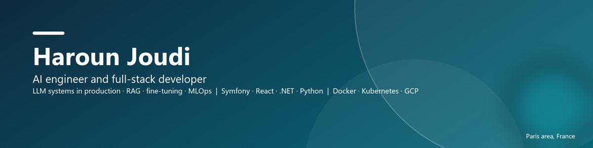

  

  Computer science engineer (CY Tech, 2026, AI major) with three years of backend and full-stack development in production. 
  Today I build applied AI: LLM assistants, RAG pipelines, model fine-tuning and MLOps, on top of solid web engineering.

 

### Startups I help build

<table>
  <tr>
    <td width="34%" valign="top">
      

      <h3 align="center"><a href="https://webntricks.com">Webntricks</a></h3>
      
Digital studio in Cergy: AI-augmented e-commerce, ERP and CRM integrations, full-stack builds, SEO and maintenance.

      
Brand and platform: development, maintenance, testing, SEO and marketing support

    </td>
    <td width="33%" valign="top">
      

      <h3 align="center"><a href="https://auramur.fr">AuraMur</a></h3>
      
Made-to-measure printed wallpaper, produced in France. I helped build the brand and the web platform, and ran a research proof of concept: fine-tuning FLUX.2 9B on 2,500 of their designs to generate new patterns.

      
Brand and platform · AI research and proof of concept

    </td>
    <td width="33%" valign="top">
      

      <h3 align="center"><a href="https://sentinelo.fr">Sentinelo</a></h3>
      
Maintenance platform for agencies and freelancers: monitoring, backups and updates for WordPress, WooCommerce and PrestaShop sites, white-label.

      
Brand and platform: development, maintenance, testing, SEO and marketing support

    </td>
  </tr>
</table>

### In production

<table>
  <tr>
    <td width="50%" valign="top">
      

      <h4>EcoPilot, an AI assistant inside Outlook</h4>
      Summarises and drafts e-mails, acts on the calendar, contacts and files, by chat or voice. OpenAI Assistants with tool calls, React/TypeScript, a C#/.NET VSTO extension for private mail servers. Used every day by the 50 office employees of a Swiss company since 2025.
    </td>
    <td width="50%" valign="top">
      

      <h4>Middle Business CRM at OHM Énergie</h4>
      B2B energy subscription CRM in Symfony 6, built from architecture to production in a two-person team: multi-meter subscriptions, pricing, DocuSign contracts, a parallel processing engine for the Enedis/GRDF APIs (50 calls per second) and a real-time dashboard with 20+ KPIs.
    </td>
  </tr>
</table>

### Open-source work

| Repository | What it is |
|---|---|
| [purchase-predict-mlops](https://github.com/Haroun-j/purchase-predict-mlops) | End-to-end MLOps: Kedro pipeline, MLflow registry, Flask API, Cloud Build, Cloud Run and GKE |
| [Multi-Agent-Chatbot](https://github.com/Haroun-j/Multi-Agent-Chatbot) | LangChain orchestrator with sales and support agents backed by database tools |
| [airport-digital-twin-nox](https://github.com/Haroun-j/airport-digital-twin-nox) | Neural SDF reconstruction of Orly airport and 3D U-Net prediction of NOx dispersion |
| [herbarium-crossvit](https://github.com/Haroun-j/herbarium-crossvit) | CrossViT classification of herbarium sheets with patch weighting and attention rollout |
| [Big-Data-NYC-Taxi-Pipeline](https://github.com/Haroun-j/Big-Data-NYC-Taxi-Pipeline) | Spark ingestion of 36.6M taxi trips, star-schema warehouse, Airflow, fare prediction |
| [GenAI-Noise-diffusion](https://github.com/Haroun-j/GenAI-Noise-diffusion) | Does a diffusion model need Gaussian noise? A controlled study plus a battery monitoring prototype |
| [prestigio](https://github.com/Haroun-j/prestigio) | Symfony 6 e-commerce site: EasyAdmin back office, Stripe, coupons, product variations |
| [ml-notebooks](https://github.com/Haroun-j/ml-notebooks) | Course notebooks: NLP, deep learning, data analysis, optimisation |
| [cuda-kernels-lab](https://github.com/Haroun-j/cuda-kernels-lab) · [viking-hunter-java](https://github.com/Haroun-j/viking-hunter-java) · [4X-Game-Java-EE](https://github.com/Haroun-j/4X-Game-Java-EE) | Smaller projects: CUDA kernels, two Java games |

### Stack

  
  
  
  
  
  

  
  
  
  
  
  
  

  
  
  
  
  
  

### Contact

Based near Paris, open to AI engineering and full-stack roles. harounjoudi.dev@gmail.com · [LinkedIn](https://www.linkedin.com/in/haroun-joudi)
